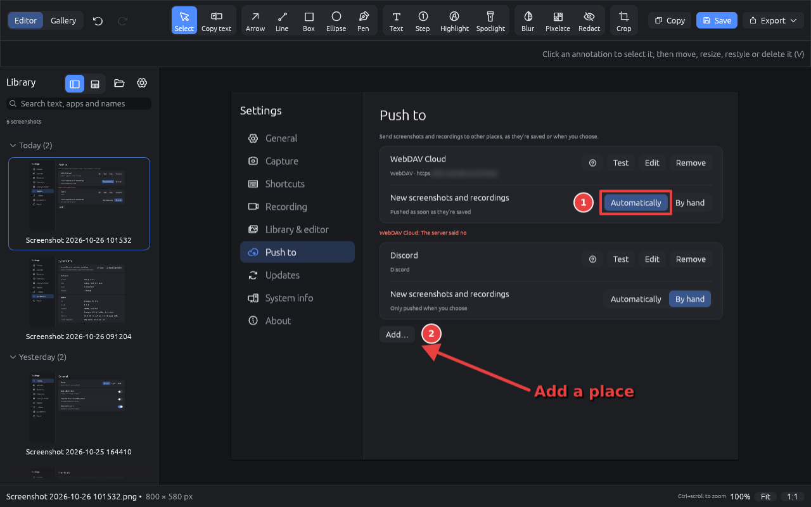

# RSnip

A small, open-source, Snagit-style screenshot tool for Windows and Linux, written in Rust. On
Windows it does everything below; on Linux it takes screenshots and recordings too, from the
command line or a desktop shortcut, with a few things Windows-only (see
[RSnip on Linux](docs/linux.md)).

## Highlights

- **Capture** a region, a window, one screen or all screens, the same area as last time, a long
  page with a scrolling capture, after a delay, or just the text in an area (OCR). On Windows it
  takes over Print Screen (and optionally Win+Shift+S), freezes the screen to select from, and can
  pin a capture to the screen. Or click the tray icon for a capture panel with the options for an
  image or a video, and a red button to start. [More](docs/capturing.md)
- **Copied and saved** every time: each capture goes to the clipboard and to RSnip's folder, and
  every action can have its own shortcut. [Settings](docs/settings.md)
- **Annotate** with arrows, lines, boxes, ellipses, steps, text, highlighter, spotlight and a pen,
  and crop. Everything stays selectable, and annotations stay editable after saving.
  [More](docs/editor.md)
- **Hide what shouldn't be seen** with blur, pixelate or redact, or let *Auto-redact* find the
  emails, keys and card numbers for you. [More](docs/editor.md#tools)
- **Copy text** from a screenshot: pick out the words and copy them. [More](docs/editor.md#tools)
- **Record** an area to MP4 or GIF, play it in the library and trim it to a new file without
  re-encoding. [More](docs/capturing.md) and [the player](docs/editor.md#recordings)
- **Library and Gallery**: browse every screenshot, grouped by date (the groups fold away), and
  search by the words in them, the app and window they came from, and their name. The Gallery page
  shows large thumbnails, sorted by date, name, size or type, with the selected one's details beside
  it. [More](docs/editor.md#the-library)
- **Push to other places**, as they're saved or when you choose: SFTP, WebDAV, S3, SMB shares,
  FTPS, Discord, Slack, Immich, PhotoPrism, or any upload API (ShareX `.sxcu` uploaders too).
  [More](docs/destinations.md)
- **Updates** itself when you want it to: it says when a new version is out, and an installed copy
  can download, check and install it. [Settings](docs/settings.md)
- **Windows and Linux**: Windows has everything; Linux has the library and editor, screenshots and
  recording. Scrolling capture, pinning and dragging files out are Windows-only.
  [RSnip on Linux](docs/linux.md)

## Download

Get the [latest release](https://github.com/dhiorns15/rust-screenshot/releases/latest).

- **Windows** (10 or later, 64-bit): the installer, `rsnip-vX.Y.Z-windows-x64-setup.exe`, or
  `rsnip.exe` on its own (also in a zip). See [Installing on Windows](docs/windows.md).
- **Linux** (x86-64): a `.deb`, an `.rpm` or `rsnip-vX.Y.Z-linux-x64.tar.gz`. See
  [Installing on Linux](docs/linux.md#installing-on-linux).

## Documentation

- [Installing on Windows](docs/windows.md): the installer, or `rsnip.exe` on its own
- [Capturing](docs/capturing.md): every way to capture or record, and the shortcuts
- [The editor, library and Gallery](docs/editor.md): tools, saving, exporting, search, the Gallery
  and trimming recordings
- [Places to push to](docs/destinations.md): sending to other places, and how to set up each
- [Settings](docs/settings.md): each section of the Settings window, and crash reports
- [Command line](docs/command-line.md): the `rsnip` options
- [RSnip on Linux](docs/linux.md): what works, installing, screenshots and recording
- [Troubleshooting](docs/troubleshooting.md)
- [Building](docs/building.md): from source, the tests and releases

The full index is [docs/README.md](docs/README.md).

## Contributing

Contributions are welcome, including AI-assisted ones (every pull request is also reviewed with AI).
See [CONTRIBUTING.md](CONTRIBUTING.md) for building, the test suite and what a pull request needs.

## License

MIT
